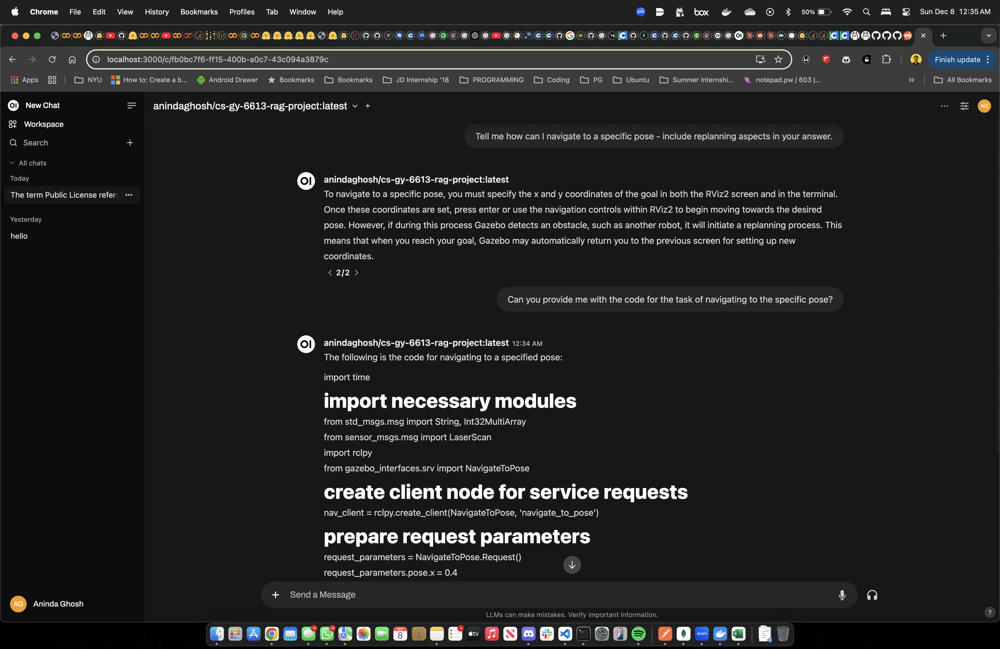
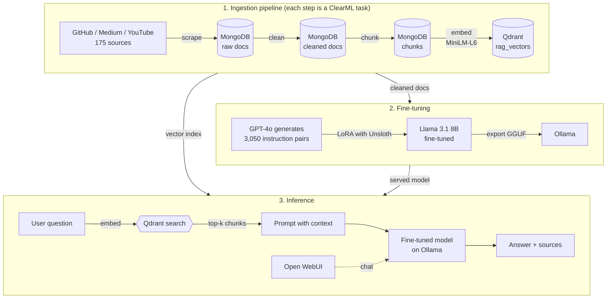

# ROS2 Robotics Assistant: a fine-tuned RAG system

A Retrieval-Augmented Generation (RAG) assistant that answers questions for ROS2 robotics developers. It covers four subdomains: **ROS2 middleware**, **Nav2** navigation, **MoveIt2** motion planning and **Gazebo** simulation.

The project covers the full lifecycle: scraping a domain corpus, cleaning and chunking it, embedding it into a vector database, generating a synthetic instruction dataset, fine-tuning Llama 3.1 8B with LoRA, and serving the model locally behind a chat UI. Every step is tracked with ClearML.

Built for CS-GY 6613 (Artificial Intelligence) at NYU Tandon.

| Artifact | Link |
| --- | --- |
| Fine-tuned model (Hugging Face) | [anindaghosh/cs-gy-6613-rag-project](https://huggingface.co/anindaghosh/cs-gy-6613-rag-project) |
| Fine-tuned model (Ollama) | [anindaghosh/cs-gy-6613-rag-project](https://ollama.com/anindaghosh/cs-gy-6613-rag-project) |
| Instruction dataset | [anindaghosh/cs-gy-6613-rag-instruct-set](https://huggingface.co/datasets/anindaghosh/cs-gy-6613-rag-instruct-set) |
| Fine-tuning notebook | [Open in Colab](https://colab.research.google.com/github/anindaghosh/cs-gy-6613-artificial-intelligence-project/blob/main/notebooks/02_finetune_llama3_lora.ipynb) |



## Highlights

- **175 curated sources** (86 GitHub repositories, 66 Medium articles, 23 YouTube videos) scraped into MongoDB.
- **Vector search** over 384-dimensional `all-MiniLM-L6-v2` embeddings stored in Qdrant with cosine similarity. Each chunk keeps its source URL so answers can cite where they came from.
- **3,050 synthetic instruction and answer pairs** generated with GPT-4o from the cleaned corpus and published to Hugging Face.
- **LoRA fine-tuning of Llama 3.1 8B** in 4-bit with Unsloth: rank 16 adapters on all attention and MLP projections (41.9M trainable parameters), one epoch on a single A100.
- **Local serving**: the model is exported to GGUF (Q8_0), pushed to Ollama and used through Open WebUI.
- **Reproducible infrastructure**: MongoDB, Qdrant, ClearML, Ollama and Open WebUI all run from one `docker-compose.yml`.

## Architecture



### 1. Ingestion (`app/scraper.py`)
Source URLs live in `data/media_urls.json` and are loaded into MongoDB on the first run. Each platform has its own scraper:
- **GitHub**: shallow-clones the repository and stores the text of every file, skipping binaries and lockfiles.
- **Medium**: fetches the article and extracts the title, subtitle, author, date and body with BeautifulSoup.
- **YouTube**: pulls the English transcript with `youtube-transcript-api`.

### 2. Cleaning and chunking (`app/preprocessing/`)
Each document is normalized per platform, stripped of non-ASCII symbols and collapsed whitespace, then split into chunks of about 2,000 characters on word boundaries.

### 3. Featurization (`app/featurizer.py`)
Chunks are embedded with `sentence-transformers/all-MiniLM-L6-v2` (mean pooling) and upserted into the Qdrant `rag_vectors` collection along with their text, platform and URL.

### 4. Instruction dataset (`app/generate_instruct_dataset.py`, `app/export_instruct.py`)
GPT-4o reads the cleaned corpus in chunks and writes five self-contained instruction and answer pairs per chunk, in the style of the source material. Duplicates are skipped and the result is exported to Hugging Face.

### 5. Fine-tuning (`notebooks/02_finetune_llama3_lora.ipynb`)
Runs on Colab. Llama 3.1 8B is loaded in 4-bit and trained with LoRA (r=16, alpha=16) through TRL's `SFTTrainer`: learning rate 2e-4, effective batch size 8, 8-bit AdamW, 381 steps. The adapters are merged and exported to GGUF for Ollama.

### 6. Retrieval and generation (`app/rag.py`)
The question is embedded with the same model used for the corpus. Qdrant returns the top-k chunks, which are placed into the prompt for the fine-tuned model served by Ollama. The answer is printed with the source URLs it was grounded in.

## Tech stack

| Area | Tools |
| --- | --- |
| Language | Python |
| Data and storage | MongoDB, Qdrant |
| Scraping | Requests, BeautifulSoup, youtube-transcript-api, Git |
| Embeddings | Hugging Face Transformers, PyTorch, all-MiniLM-L6-v2 |
| Dataset generation | OpenAI GPT-4o, Hugging Face Datasets |
| Fine-tuning | Llama 3.1 8B, LoRA, Unsloth, TRL |
| Serving | Ollama (GGUF), Open WebUI |
| MLOps | ClearML, Docker Compose |

## Repository layout

```
app/
  scraper.py                   # GitHub, Medium and YouTube scrapers
  preprocessing/clean.py       # per-platform cleaning
  preprocessing/chunk.py       # chunking
  featurizer.py                # embeddings into Qdrant
  pipeline.py                  # runs the ingestion steps in order
  generate_instruct_dataset.py # GPT-4o instruction pairs
  export_instruct.py           # publish dataset to Hugging Face
  rag.py                       # retrieve from Qdrant, answer with Ollama
  configs.py                   # settings from .env
notebooks/
  01_etl_and_featurization.ipynb
  02_finetune_llama3_lora.ipynb
data/media_urls.json           # the 175 source URLs
qdrant_storage/                # snapshot of the populated vector store
docker-compose.yml
```

## Running it locally

**Prerequisites:** Docker, Python 3.11+, and about 10 GB of disk for the model.

1. Clone the repository and install the dependencies.

   ```bash
   git clone https://github.com/anindaghosh/cs-gy-6613-artificial-intelligence-project
   ```

   ```bash
   cd cs-gy-6613-artificial-intelligence-project
   ```

   ```bash
   python -m venv venv && source venv/bin/activate
   ```

   ```bash
   pip install -r requirements.txt
   ```

2. Copy the environment file. The defaults match `docker-compose.yml`. `OPENAI_API_KEY` and `HF_TOKEN` are only needed to regenerate and publish the dataset.

   ```bash
   cp .env.example .env
   ```

3. Start the services (MongoDB, Qdrant, ClearML, Ollama, Open WebUI).

   ```bash
   docker compose up -d
   ```

4. Pull the fine-tuned model into Ollama.

   ```bash
   docker compose exec ollama ollama pull anindaghosh/cs-gy-6613-rag-project
   ```

5. Ask a question. The committed `qdrant_storage/` snapshot means retrieval works without re-running ingestion.

   ```bash
   python -m app.rag "How do I navigate to a specific pose with Nav2, including replanning?"
   ```

   To chat with the model directly instead, open Open WebUI at http://localhost:3000.

### Rebuilding the corpus

Run every ingestion step (scrape, clean, chunk, featurize), or only some of them:

```bash
python -m app.pipeline
```

```bash
python -m app.pipeline --steps chunk featurize
```

Each step is logged as a separate ClearML task, visible at http://localhost:8080. The same steps can be run interactively in `notebooks/01_etl_and_featurization.ipynb`.

### Regenerating the instruction dataset

```bash
python -m app.generate_instruct_dataset
```

```bash
python -m app.export_instruct
```

## Lessons learned and next steps

- **Fine-tuning teaches style more than facts.** With retrieval switched off, the model sometimes answers Nav2 questions with ROS1 concepts such as `move_base`. Grounding answers in retrieved chunks matters more than more training steps, which is why `app/rag.py` passes the context explicitly.
- **Evaluation is the main gap.** A next step would be a held-out question set scored for retrieval hit rate and answer faithfulness (for example with RAGAS), so changes to chunking or models can be compared with numbers.
- **Chunking is naive.** Fixed-size chunks split code blocks and Markdown sections. Splitting on headings and code fences, plus a reranker on the retrieved chunks, would likely improve answer quality.
- **The pipeline runs sequentially.** The steps are tracked in ClearML but not yet scheduled as a ClearML pipeline with caching between steps.

## Team

- **Aninda Ghosh** ([GitHub](https://github.com/anindaghosh), [Hugging Face](https://huggingface.co/anindaghosh))
- **Samrudhi Baldota** ([GitHub](https://github.com/samrudhibaldota))
